# ER — データモデル（テーブル構成）

現在の DB スキーマの ER 図とテーブル定義。**モデル（SQLAlchemy）とマイグレーションが
正本**で、本書はそれを読み手向けに図示したもの。

> **更新ルール**: テーブル・カラム・リレーション・制約を変更したとき
> （モデルの変更と Alembic マイグレーションの追加）は、**同じコミットでこのファイルを
> 更新する**。新しいテーブルは「ER 図」と「テーブル定義」の両方に追記する。

正本の場所:

| 対象 | 場所 |
|---|---|
| 共有テーブルのモデル | `shared/infrastructure/models/` |
| コンテキスト固有テーブルのモデル | `bounded_contexts/<context>/infrastructure/` |
| DDL（適用順） | `migrations/versions/` |
| マスタデータ（ロール・権限・初期管理者）の値 | `shared/domain/auth/master_data.py` |

モデルとマイグレーションの乖離は
`tests/integration/test_migration_model_consistency.py` が検出する。

---

## ER 図

```mermaid
erDiagram
    users ||--o{ user_roles : "所属する"
    users ||--o| user_session_boundaries : "ログインを区切る"
    roles ||--o{ user_roles : "割り当てられる"
    roles ||--o{ role_permissions : "持つ"
    permissions ||--o{ role_permissions : "付与される"
    users ||--o{ password_reset_tokens : "発行する"
    users ||--o| totp_secrets : "登録する"
    users ||--o{ passkey_credentials : "登録する"
    users ||--o{ webauthn_challenges : "発行する（ログイン用は NULL）"
    users ||--o{ federated_identities : "外部 IdP と結び付く"
    users ||--o{ sso_login_tickets : "引き換え券を受け取る"
    user_groups ||--o{ user_group_members : "束ねる"
    users ||--o{ user_group_members : "所属する"
    notifications ||--o{ notification_deliveries : "配られる"
    users ||--o{ notification_deliveries : "受け取る"
    users ||--o{ web_push_subscriptions : "端末で購読する"
    users ||--o{ app_device_tokens : "アプリを入れた端末"
    tenants ||--o{ user_tenants : "人が属する"
    users ||--o| user_tenants : "ちょうど 1 つに属する（システム管理者は無し）"
    tenants ||--o{ user_groups : "持つ"
    tenants ||--o{ notifications : "持つ"
    tenants ||--o{ items : "持つ"
    tenants ||--o{ role_tenants : "自分のロールを持つ"
    roles ||--o| role_tenants : "作ったテナント（無ければ共有の雛形）"

    role_tenants {
        bigint role_id PK,FK "roles.id（ON DELETE CASCADE）"
        bigint tenant_id FK "索引あり"
    }

    tenants {
        bigint id PK
        varchar(50) slug UK "URL に使う短い名前"
        varchar(100) display_name
        varchar(255) issuer UK "assay の発行者。NULL = SSO なし"
        varchar(255) client_id "そのテナントに登録したクライアント ID"
        varchar status "active / suspended（CHECK 付き）"
        datetime created_at "UTC"
    }

    user_tenants {
        bigint user_id PK,FK "users.id（ON DELETE CASCADE）"
        bigint tenant_id FK "索引あり"
    }

    app_device_tokens {
        bigint id PK
        bigint user_id FK
        varchar(64) token_sha256 UK
        text token "FCM の登録トークン"
        varchar(16) platform "android"
        datetime created_at "UTC"
        datetime updated_at "UTC（最後に登録し直した時刻）"
    }

    user_groups {
        bigint id PK
        bigint tenant_id FK "索引あり"
        varchar(100) name "テナントの中で一意"
        varchar(255) description
        datetime created_at "UTC"
    }

    notifications {
        bigint id PK
        bigint tenant_id FK "索引あり"
        varchar(200) title
        text body
        varchar(1000) link_url "NULL 可。/パス か http(s)://"
        boolean in_bell
        boolean in_banner
        boolean by_push
        varchar audience_kind "all / group / user"
        bigint audience_target_id "FK なし"
        bigint sender_user_id "FK なし"
        datetime sent_at "UTC"
    }

    notification_deliveries {
        bigint notification_id PK,FK
        bigint user_id PK,FK
        datetime read_at "NULL = 未読"
        datetime dismissed_at "NULL = 上部に出す"
    }

    web_push_subscriptions {
        bigint id PK
        bigint user_id FK
        varchar(64) endpoint_sha256 UK
        text endpoint
        varchar(255) p256dh
        varchar(255) auth
        datetime created_at "UTC"
    }

    users {
        bigint id PK
        varchar(255) email "索引あり・一意は同じ席の中だけ（ADR-0064）"
        varchar(100) username
        varchar(255) password_hash "NULL = ローカル認証なし（ADR-0038）"
        boolean is_active "既定 true"
        datetime created_at "UTC"
        datetime updated_at "UTC"
    }

    user_session_boundaries {
        bigint user_id PK,FK "users.id（ON DELETE CASCADE）"
        datetime valid_from "これより前のトークンでは更新させない（ADR-0057）"
    }

    roles {
        bigint id PK
        varchar(50) name UK "owner / manager / member / guest / system-admin / user-admin / auditor（ADR-0051・0052）"
    }

    permissions {
        bigint id PK
        varchar(100) code UK "scope（例: user:manage）"
    }

    user_roles {
        bigint user_id PK,FK
        bigint role_id PK,FK
    }

    role_permissions {
        bigint role_id PK,FK
        bigint permission_id PK,FK
    }

    password_reset_tokens {
        bigint id PK
        bigint user_id FK "索引あり"
        varchar(64) token_hash UK "ハッシュのみ保存"
        datetime expires_at
        datetime used_at "使用済みなら非 NULL"
        datetime created_at
    }

    totp_secrets {
        bigint user_id PK,FK "ユーザー 1 人につき 1 行"
        varchar(64) secret
        datetime confirmed_at "NULL = 登録手続き中"
        datetime created_at
        datetime updated_at
    }

    passkey_credentials {
        bigint id PK
        bigint user_id FK "索引あり"
        varchar(255) credential_id UK "base64url"
        text public_key
        bigint sign_count "既定 0"
        json transports
        varchar(100) name
        varchar(64) attestation_format
        varchar(64) aaguid
        boolean backup_eligible "既定 false"
        boolean backup_state "既定 false"
        datetime last_used_at
        datetime created_at
        datetime updated_at
    }

    webauthn_challenges {
        varchar(32) challenge_id PK
        varchar(255) challenge
        varchar purpose "registration / authentication（CHECK 付き）"
        bigint user_id FK "ログイン用は NULL"
        datetime expires_at "索引あり"
        datetime created_at
    }

    login_attempts {
        varchar(32) purpose PK "login / password_reset（CHECK 付き）"
        varchar(255) identifier PK "送られてきたメールアドレス（users とは結ばない）"
        int failures
        datetime window_started_at "NULL 可"
        datetime locked_until "NULL 可。これより前は断る"
        datetime updated_at
    }

    system_settings {
        varchar(100) setting_key PK
        json setting_json
        datetime updated_at
    }

    log {
        bigint id PK
        datetime created_at "索引あり・UTC"
        varchar(20) level "索引あり"
        varchar(120) logger "索引あり"
        text message
        varchar(36) request_id "索引あり"
        varchar(64) user_id_hash "索引あり・PII を持たないためハッシュのみ"
        varchar(255) path
        varchar(10) method
        int status_code
        int duration_ms
        text trace "例外時のみ"
    }

    audit_log {
        bigint id PK
        bigint tenant_id "索引あり・FK は張らない。NULL = 全体の操作"
        datetime occurred_at "索引あり・UTC"
        varchar(64) event_type "索引あり（例: login.failed）"
        varchar result "索引あり・success / failure（CHECK 付き）"
        bigint actor_user_id "索引あり・FK は張らない。未認証の失敗は NULL"
        varchar(64) target_type "索引あり・user / role / system_setting 等"
        varchar(64) target_id "対象の内部 ID"
        varchar(45) ip_address
        varchar(512) user_agent
        varchar(255) reason "失敗の分類・変更した項目名（値は入れない）"
        varchar(36) request_id "索引あり・log.request_id と同じ値"
    }

    items {
        bigint id PK
        bigint tenant_id FK "索引あり"
        varchar(255) name
    }
```

`system_settings` / `log` / `audit_log` は他テーブルと FK で結ばれない（意図的）。

- `log` はユーザーへ FK を張らない。PII を持たず `user_id_hash` だけを記録する方針のため
  （CLAUDE.md「ログ」）。ユーザーを消してもログは残る。
- `audit_log` も FK を張らない。追記専用の記録で、ユーザーを削除しても「誰が何をしたか」の
  行を残さなければならないため（ADR-0013）。`actor_user_id` は `users.id` と同じ値だが
  参照整合は取らない。
- `log.request_id` と `audit_log.request_id` は同じ値が入る。片方で見つけた ID をもう一方の
  絞り込みに入れると、1 リクエストの記録を両側から突き合わせられる。
- `system_settings` は設定キーごとの上書き値を持つ独立テーブル。
- `items` は `bounded_contexts/example`（新機能追加の見本）のテーブル。

---

## テナント（ADR-0061・ADR-0062）

全部の表が「誰のものか」を宣言している（`__table_args__` の `info`。`shared/infrastructure/models/tenancy.py`）。
宣言の無い表・宣言と列が食い違う表は `tests/integration/test_table_tenancy.py` が落とす。

| 区分 | 意味 | 表 |
|---|---|---|
| テナントの表（`TENANT`） | テナントの中身。`tenant_id` を持ち、読み書きは主体のテナントで絞る | `items` / `user_groups` / `notifications` / `audit_log` / `role_tenants` |
| 利用者に付く表（`PERSONAL`） | `user_id` で利用者に従う。テナントは利用者を通して決まる | `users` / `user_tenants` / `user_roles` / `user_group_members` / `user_session_boundaries` / `password_reset_tokens` / `totp_secrets` / `passkey_credentials` / `webauthn_challenges` / `federated_identities` / `sso_login_tickets` / `notification_deliveries` / `web_push_subscriptions` / `app_device_tokens` |
| 全体の表（`GLOBAL`） | アプリ全体のもの | `tenants` / `roles` / `permissions` / `role_permissions` / `system_settings` / `log` / `login_attempts` / `federated_session_revocations` |

| テーブル | 役割 | モデル |
|---|---|---|
| `tenants` | テナント。1 行が assay のテナント 1 つに当たり、発行者（`issuer`）で見分ける。`issuer` が NULL のテナントは SSO を使わない（ローカル口座だけ）。`status` が `suspended` のテナントの人は入れない | `tenant.py` |
| `role_tenants` | テナントが自分で作ったロールの持ち主（1 ロール 1 行。ADR-0063）。行の無いロールは雛形で全テナントが共有し、テナントの管理者からは中身を変えられない | `tenant.py` |
| `user_tenants` | 利用者の所属（1 人 1 行）。行が無いのはシステム管理者だけ。`users` の列にしないのは、古い移行が `User` のモデルで `users` を書くため | `tenant.py` |

`audit_log.tenant_id` は外部キーを張らない（テナントを消しても記録は残す）。NULL は全体の操作
（システム管理者の操作・宛先の分からない失敗）。

---

## テーブル定義

### 認証・認可（`shared/infrastructure/models/`）

| テーブル | 役割 | モデル |
|---|---|---|
| `users` | ユーザー。`email` の一意は**同じ席の中だけ**（同じテナントの中、テナントに属さない人の中。ADR-0064）で、DB には一意制約を置かずアプリが確かめる。無効化は削除ではなく `is_active` で行う。⚠ **`password_hash` が NULL = ローカル認証を持たない**（ADR-0038）。「空のパスワード」でも「誰も知らない値が入っている」でもない | `user.py` |
| `user_session_boundaries` | ログインの区切り（ADR-0057）。1 人 1 行。`valid_from` より前に出したトークンでは更新・出し直しをさせない。パスワードを変えた・再設定した・管理者が付け直したときに入る。行が無ければ区切り無し。`users` の列にしないのは、古い移行が `User` のモデルで `users` を書くため | `user.py` |
| `roles` | ロール。`id` は `user_roles` からの参照キーとして固定値で投入する | `role.py` |
| `permissions` | 権限コード（scope）。`code` を安定キーとし `id` は DB 採番 | `role.py` |
| `user_roles` | ユーザー ⇔ ロール（多対多） | `user.py` |
| `role_permissions` | ロール ⇔ 権限（多対多） | `role.py` |
| `password_reset_tokens` | パスワード再設定トークン。平文は保存せずハッシュのみ | `user.py` |
| `user_groups` | グループ（人の束。権限は持たない。ADR-0047）。名前はテナントの中で一意（`uq_user_groups_tenant_name`）。⚠ 表の名前を `groups` にしない（MySQL 8 / MariaDB の予約語） | `group.py` |
| `user_group_members` | グループ ⇔ ユーザー（多対多）。どちらの FK も `ON DELETE CASCADE` | `group.py` |

保有権限は**ユーザーが持つ全ロールの権限の和集合**（`User.permission_codes`）。
実際に有効な scope はアクティブロールで決まり、ロールを 1 つ選んでいるあいだは
そのロール分だけになる（`User.permission_codes_of`。ADR-0017）。アクティブロールは
JWT のクレームでありテーブルには持たない（セッションごとの状態のため）。
認可はロール名ではなく scope で判定する（ADR-0002）。

### アカウントセキュリティ（`bounded_contexts/account_security/infrastructure/`）

| テーブル | 役割 |
|---|---|
| `totp_secrets` | TOTP 共有鍵。`user_id` が主キー（1 ユーザー 1 行）。`confirmed_at` が NULL のあいだは登録手続き中で二要素認証は未有効 |
| `passkey_credentials` | WebAuthn 資格情報。`credential_id`（base64url）で持ち主を引く。`sign_count` はリプレイ検知用 |
| `webauthn_challenges` | 発行済みチャレンジ。複数ワーカー構成でも検証できるようプロセスメモリではなく DB に置く。ログイン用は発行時点で相手が不明なため `user_id` が NULL |
| `login_attempts` | 宛名ごとの失敗の控え（ADR-0058）。窓の中で上限まで失敗したら `locked_until` まで断る。宛名は送られてきたメールアドレスで、実在するアカウントとは結ばない（断られ方で存在が分からないように）。期限切れの行は書き込みのたびに掃除する | `account_security_models.py` |

`users.id` への FK は 3 つとも `ON DELETE CASCADE`（ユーザー削除で資格情報も消える）。
経緯は ADR-0003。

### ID 連携（`bounded_contexts/identity_federation/infrastructure/`）

| テーブル | 役割 |
|---|---|
| `federated_identities` | 外部 IdP のアカウントと利用者の結び付き。鍵は `(issuer, subject)`。**メールアドレスは鍵にしない**（変わり得るため）。利用者側に一意制約は置かない（1 人が複数の IdP アカウントを持てる） |
| `sso_login_tickets` | コールバックが発行する 1 回限りの引き換え券。**ハッシュだけを保存する**（漏れた控えからそのままログインできないようにする）。期限切れは券の発行時に掃除するので定期ジョブは持たない。`issuer` / `subject` / `session_id` / `session_started_at` は、券と一緒に運ぶ**どの IdP セッションから始まったログインか**（ADR-0036） |
| `federated_session_revocations` | IdP から届いた「このセッションを止めろ」の記録（ADR-0036）。主キーは `jti` で、**再送はそのまま行の重複として弾かれる**。`session_id` が NULL の行はその利用者のすべてのセッションに効く。期限切れは通知を受けるたびに掃除するので定期ジョブは持たない |

⚠ **認可要求の往復状態（`state` / `nonce` / `code_verifier`）の表は無い。** 署名付き
Cookie でブラウザに預けるため（ADR-0025）。保管も掃除も要らず、`state` を知って
いるだけの相手は戻りを完了できない。

`users.id` への FK は `federated_identities` と `sso_login_tickets` の 2 つで、どちらも
`ON DELETE CASCADE`。経緯は ADR-0025。

⚠ **`federated_session_revocations` は `users` へ FK を張らない。** 行が指すのは
**IdP 側の利用者**（`issuer` + `subject`）で、このアプリに対応する行がまだ無い・
もう無い場合がある。参照整合を取ると、そのとき通知を受けられなくなる。

### お知らせ（`bounded_contexts/notification/infrastructure/`。ADR-0047）

| テーブル | 役割 |
|---|---|
| `notifications` | 送ったお知らせ 1 通 1 行。出す場所は列を分けて持つ（`in_bell` / `in_banner` / `by_push`）。宛先と送り手は**FK を張らない**（相手を消しても「誰に・誰が送ったか」を残す） |
| `notification_deliveries` | 宛先の 1 人ずつ。**送った時点の顔ぶれ**で書く（あとからグループに入った人には届かない）。`read_at` が NULL で `in_bell` なら未読としてベルに数える。`dismissed_at` が NULL で `in_banner` なら画面上部に出す |
| `web_push_subscriptions` | 端末（ブラウザ）1 つの Web Push の購読。⚠ `endpoint` は数百文字で索引の上限を超えるので、一意は `endpoint_sha256` で取る。同じ端末で別の人がログインし直して購読すると、後の人のものに書き換わる |
| `app_device_tokens` | スマホアプリ 1 台の FCM の登録トークン（ADR-0049）。アプリが起動・サインインのたびに登録し直し、`updated_at` が進む。一意は `token_sha256` で取る。FCM が `UNREGISTERED` と答えたら消す |

`users.id` への FK は `notification_deliveries` と `web_push_subscriptions` と `app_device_tokens` の 3 つで、
どれも `ON DELETE CASCADE`。

### 運用・その他

| テーブル | 役割 | モデル |
|---|---|---|
| `system_settings` | 設定の上書き層。優先順位は **DB > 環境変数 > デフォルト値**（ADR-0034）| `shared/infrastructure/models/system_setting.py` |
| `log` | アプリログ（システムが何をしたか）。`request_id` でリクエスト単位に追跡する。索引は絞り込み軸（レベル・ロガー・利用者・期間・`request_id`）に対応する | `shared/infrastructure/models/log.py` |
| `audit_log` | 監査ログ（誰が何をしたか）。ログイン・ユーザー／ロール管理・設定変更・再起動要求・MFA の変更を記録する | `bounded_contexts/audit/infrastructure/audit_log_model.py` |
| `items` | example コンテキストのサンプルテーブル | `bounded_contexts/example/infrastructure/item_model.py` |

`log` と `audit_log` の使い分け（ADR-0013）:

| | `log` | `audit_log` |
|---|---|---|
| 残すもの | システムが何をしたか（リクエスト・警告・例外） | 誰が何をしたか（操作と結果） |
| 書き手 | `shared/kernel/logging` の `DbLogHandler`（全レイヤーから） | audit コンテキストのユースケース（ルーターから明示的に） |
| 量・寿命 | 多い・短命（`LOG_DB_MIN_LEVEL` で間引ける） | 少ない・長命（間引かない） |
| 保持期間 | `LOG_RETENTION_DAYS` | `AUDIT_LOG_RETENTION_DAYS` |
| 閲覧 scope | `log:view` | `audit:view` |

保持期間はどちらも既定 `0`（＝削除しない）で、キーを分けてある。アプリログを削る運用が
監査記録を巻き込まないようにするため（ADR-0021。設定手順は `docs/OPERATIONS.md`）。

`audit_log.actor_user_id` は不可逆ハッシュではなく内部 ID を持つ。監査は操作を主体へ
帰属させるための記録で、後から誰か特定できなければ目的を果たさないため（ADR-0013）。
メールアドレス・ユーザー名・パスワード・設定値そのものは記録しない。

---

## モデリング規約

図と定義を読むときの前提。詳細は CLAUDE.md「DB モデリング」を参照。

- **DB ネイティブ ENUM を使わない。** `sa.Enum(..., native_enum=False)`（CHECK 付き
  VARCHAR）か、`String` + Python 側の許可値定数にする。
  例: `webauthn_challenges.purpose`（許可値は
  `CHALLENGE_PURPOSES` = `registration` / `authentication`）、
  `audit_log.result`（許可値は `AuditResult` = `success` / `failure`）。
  `audit_log.event_type` は素の `VARCHAR`（値が増え続けるため CHECK を付けない。
  許可値は `AuditEventType` で集中管理する）。
- **主キー等の `BigInteger`** は `sa.BigInteger().with_variant(sa.Integer(), "sqlite")`
  （`shared/infrastructure/models/base.py` の `BigIntPk`）。本番 MariaDB と
  テスト SQLite を両立させるため（ADR-0001）。
- **時刻は常に UTC**（naive datetime で保存）。生成は `shared/kernel/timestamps.utcnow`。
- **PII を保存しない列**は `*_hash` とする（`log.user_id_hash`、
  `password_reset_tokens.token_hash`）。監査ログのように「後から主体を特定できなければ
  意味がない」記録は例外で、内部 ID（`audit_log.actor_user_id`）を持つ。
  いずれの場合もメールアドレス・氏名・パスワード等の PII 自体は保存しない（ADR-0013）。

## テーブルを追加・変更するとき

1. モデルを追加・変更する（共有なら `shared/infrastructure/models/`、
   コンテキスト固有ならそのコンテキストの `infrastructure/`）。
2. **誰のものかを宣言する**（`__table_args__ = declared(Tenancy.TENANT)` など。迷ったら `TENANT`）。
   テナントの表は `tenant_id`（`tenants.id` への FK・NOT NULL）を持ち、リポジトリは
   テナントをコンストラクタで受け取って全部の読み書きを絞る（見本は `SqlItemRepository`）。
3. 共有モデルは `shared/infrastructure/models/__init__.py` に、コンテキスト固有モデルは
   `migrations/env.py` と `tests/conftest.py` に import を追加する
   （Alembic とテストがメタデータを認識できるようにするため）。
4. Alembic マイグレーションを追加する（`upgrade()` / `downgrade()` の両方を実装）。
   `ALTER TABLE` / `CREATE TABLE` の直接実行は禁止。
5. **本書（`docs/ER.md`）の ER 図とテーブル定義を更新する。**
6. `uv run pytest tests/integration/test_migration_model_consistency.py` で乖離が
   無いことを確認する。
